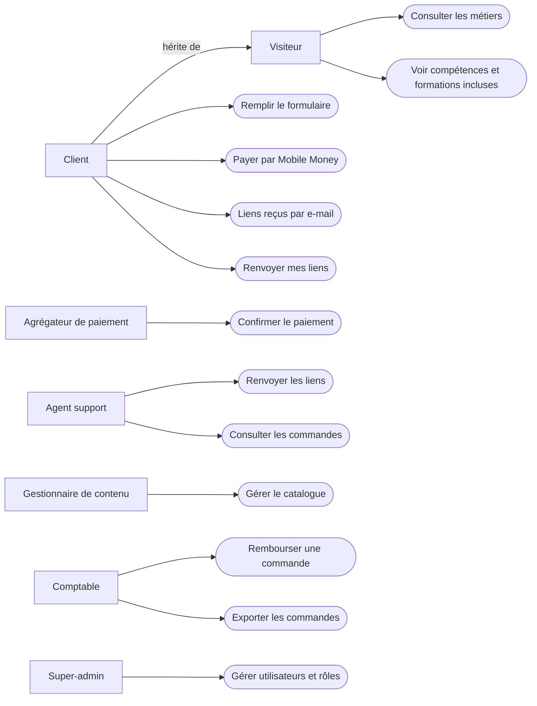
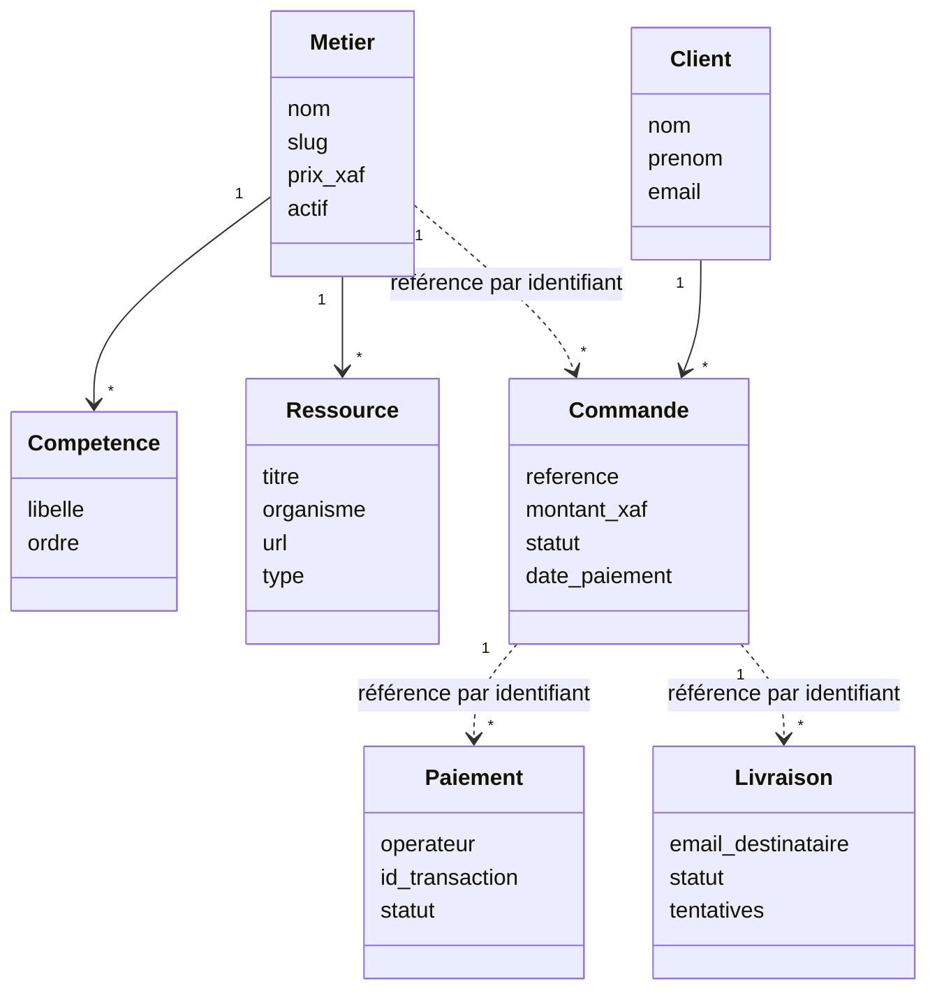
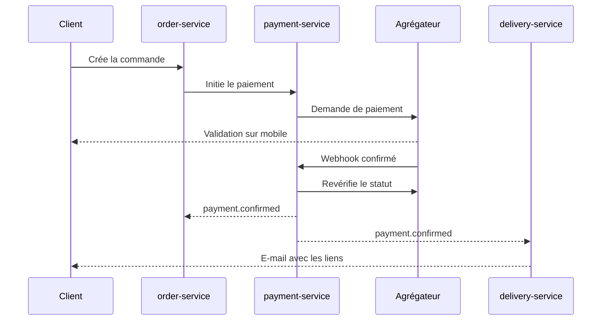

# Cahier des charges – certifpro

*Plateforme SaaS de vente de parcours de formations et certifications pour les métiers de la tech*

Rédigé en tant que développeur senior · Version 1.0 · Octobre 2026

## 1. Présentation du projet

**certifpro** est une plateforme web (SaaS) qui vend, par métier, un pack de liens de formations et de certifications reconnues. Le client choisit un métier, découvre les compétences qu'il acquerra, renseigne ses coordonnées, paie par Mobile Money, puis reçoit immédiatement l'ensemble des liens du métier choisi.

### 1.1 Objectifs

- Offrir un parcours d'achat très court : choix du métier, formulaire, paiement, livraison.
- Automatiser entièrement la livraison des liens après confirmation du paiement.
- Accepter les moyens de paiement locaux : MTN Mobile Money, Orange Money et Wave.
- Donner à l'administrateur un back-office pour gérer métiers, compétences, liens, prix et commandes.

### 1.2 Cible

Étudiants, jeunes diplômés, personnes en reconversion et professionnels en Afrique francophone (Cameroun en priorité), utilisant surtout un smartphone avec une connexion variable.

## 2. Périmètre fonctionnel

### 2.1 Métiers proposés (catalogue initial)

1. Cybersécurité
2. Ingénieur DevOps
3. Ingénieur Cloud
4. Développeur Backend
5. Développeur Frontend
6. Développeur Full Stack
7. Data Analyste
8. Data Scientist
9. Développeur IA
10. Marketing digital
11. Google Ads
12. Facebook Ads

Le catalogue doit être extensible depuis le back-office, sans intervention d'un développeur.

### 2.2 Parcours client

1. **Accueil** : présentation de certifpro et grille des métiers.
2. **Choix du métier** : le client clique sur une carte métier.
3. **Page métier** : liste des compétences obtenues à la fin du parcours, liste des formations et certifications incluses (titres et organismes visibles, liens masqués), prix du pack, bouton « Obtenir mon pack ».
4. **Formulaire** : nom, prénom, e-mail, case d'acceptation des CGV.
5. **Paiement** : choix de MTN Mobile Money, Orange Money ou Wave, puis bouton « Payer ».
6. **Confirmation** : le paiement est vérifié côté serveur.
7. **Livraison** : envoi de tous les liens par e-mail à l'adresse saisie ; la page de succès confirme uniquement l'envoi.

### 2.3 Règles de gestion

- Un pack = un métier = un prix (configurable par métier).
- Les liens ne sont jamais exposés avant paiement confirmé (ni dans le HTML, ni dans l'API publique).
- La livraison est déclenchée uniquement par la confirmation serveur du paiement (webhook ou vérification de statut), jamais par la simple redirection du navigateur.
- Une commande a un statut : `en_attente`, `payée`, `échouée`, `expirée`, `remboursée`.
- Les liens ne sont jamais affichés à l'écran : ils sont envoyés par e-mail à l'adresse saisie, après confirmation du paiement, et peuvent être renvoyés à la demande.
- L'adresse e-mail est validée avant le paiement, car elle sert à la livraison des liens.

## 3. Paiement

### 3.1 Moyens acceptés

- MTN Mobile Money
- Orange Money
- Wave

### 3.2 Intégration

Passer par un agrégateur de paiement couvrant ces trois opérateurs plutôt que trois intégrations séparées (par exemple CinetPay, Flutterwave, PayDunya ou équivalent disponible au Cameroun). Critères de choix : couverture Cameroun, frais, délai de reversement, qualité de l'API et des webhooks, sandbox. Une couche d'abstraction (`PaymentProvider`) permettra de changer de prestataire sans toucher au reste du code.

### 3.3 Flux technique

1. Création de la commande en base (`en_attente`) avec une référence unique.
2. Appel à l'API de l'agrégateur pour initier la transaction.
3. Le client valide sur son téléphone (USSD, push ou page hébergée).
4. L'agrégateur appelle le webhook de certifpro.
5. Le serveur vérifie la signature du webhook, puis recontrôle le statut via l'API de l'agrégateur.
6. Passage de la commande à `payée` et déclenchement de la livraison.
7. Tâche planifiée de réconciliation pour les commandes restées en attente.

### 3.4 Cas à gérer

- Paiement refusé, solde insuffisant, délai dépassé : message clair et bouton « Réessayer ».
- Webhook reçu en double : traitement idempotent.
- Client débité sans retour sur le site : récupération via la réconciliation et e-mail de confirmation.
- Montants stockés en entiers (XAF, sans décimales).

## 4. Livraison des liens

- Page de succès : confirme le paiement et rappelle l'adresse d'envoi, sans afficher les liens.
- E-mail transactionnel contenant tous les liens du métier choisi, envoyé à l'adresse saisie dans le formulaire (SPF, DKIM et DMARC configurés pour la délivrabilité).
- Gestion des échecs d'envoi (adresse invalide, e-mail rejeté) : alerte dans le back-office, correction possible de l'adresse puis renvoi.
- Page « Renvoyer mes liens » : saisie de l'e-mail utilisé pour la commande, renvoi des liens à cette seule adresse.

## 5. Back-office administrateur

- Authentification sécurisée avec double authentification.
- Gestion des métiers : nom, description, visuel, prix, statut actif/inactif.
- Gestion des compétences par métier.
- Gestion des formations et certifications par métier : titre, organisme, URL, ordre d'affichage.
- Suivi des commandes : filtres par statut, métier, date, opérateur ; export CSV.
- Renvoi manuel des liens, remboursement, notes internes.
- Tableau de bord : chiffre d'affaires, nombre de ventes par métier, taux de conversion, taux d'échec par opérateur.
- Codes promo (phase 2).

## 6. Architecture technique recommandée

Django en microservices : chaque service est un projet Django indépendant, avec sa propre base PostgreSQL, derrière une passerelle unique. Pour ce MVP, on garde cinq services plutôt qu'un découpage fin.

| Service | Rôle | Base de données |
| --- | --- | --- |
| gateway | Point d'entrée unique, routage, limitation de débit, HTTPS | aucune |
| site-public | Pages publiques (accueil, métier, formulaire, succès) | aucune |
| catalog-service | Métiers, compétences, ressources, prix, back-office du catalogue | catalog_db |
| order-service | Clients, commandes, statuts | order_db |
| payment-service | Initiation des paiements, webhooks, réconciliation, couche `PaymentProvider` | payment_db |
| delivery-service | Envoi des liens par e-mail | delivery_db |

Communication entre services :

- Appels synchrones en REST (Django REST Framework) via la passerelle ; un service n'accède jamais à la base d'un autre.
- Événements asynchrones via RabbitMQ : `order.created`, `payment.confirmed`, `delivery.sent`. L'événement `payment.confirmed` déclenche la livraison.
- Fiabilité : pattern Outbox et consommateurs idempotents, pour qu'un webhook ou un événement rejoué ne crée aucun doublon.
- Sécurité : JWT pour l'administrateur, jeton de service pour les appels internes, réseau interne non exposé.

| Couche | Choix proposé |
| --- | --- |
| Backend | Python / Django + Django REST Framework, un projet par service |
| Base de données | PostgreSQL, une base par service |
| Bus d'événements | RabbitMQ |
| Tâches asynchrones | Celery (e-mails, réconciliation) |
| Passerelle | Ingress Kubernetes (AWS Load Balancer Controller) ou Traefik |
| Déploiement | Conteneurs Docker, orchestration Kubernetes (Amazon EKS), infrastructure décrite en Terraform |
| CI/CD | GitHub Actions, un pipeline par service (build Docker, déploiement Helm sur Kubernetes) |
| Supervision | Sentry, journaux centralisés, traçage OpenTelemetry, sauvegardes quotidiennes des bases |

### 6.1 Modèle de données (principales entités)

- `Metier` (nom, slug, description, prix, actif)
- `Competence` (métier, libellé, ordre)
- `Ressource` (métier, titre, organisme, url, type formation/certification, ordre)
- `Client` (nom, prénom, e-mail)
- `Commande` (référence, client, métier, montant, opérateur, statut, dates)
- `Paiement` (commande, id transaction agrégateur, statut, payload brut, dates)
- `Livraison` (commande, e-mail destinataire, statut, tentatives)
- `AdminUser`, `JournalAudit`

## 7. Exigences non fonctionnelles

- **Performance** : page métier en moins de 3 secondes sur une connexion 3G.
- **Mobile first** : interface pensée smartphone d'abord, boutons larges, formulaire en une seule colonne.
- **Disponibilité** : objectif 99,5 %.
- **Sécurité** : HTTPS partout, protection CSRF/XSS/injection, limitation de débit sur les formulaires et le paiement, secrets en variables d'environnement, vérification de signature des webhooks, aucune donnée de paiement stockée sur le serveur.
- **Protection des données** : consentement explicite, politique de confidentialité, conservation limitée, accès restreint aux données clients.
- **Accessibilité et SEO** : balises sémantiques, métadonnées par métier, sitemap, pages rapides.
- **Langue** : français en priorité ; architecture prête pour l'anglais.

## 8. Pages et livrables

### 8.1 Pages publiques

Accueil · Page métier · Formulaire et paiement · Succès / échec de paiement · Renvoyer mes liens · CGV · Politique de confidentialité · Contact.

### 8.2 Livrables attendus

- Code source versionné et documenté (README, installation, variables d'environnement), Dockerfile par service, manifestes Kubernetes (Helm) et modules Terraform.
- Back-office opérationnel.
- Intégration paiement testée en sandbox puis en production.
- Jeu de données initial : 12 métiers avec compétences et liens.
- Tests automatisés sur le tunnel de commande et les webhooks.
- Documentation d'exploitation (sauvegardes, déploiement, reprise).

## 9. Planning proposé

| Phase | Contenu | Durée estimée |
| --- | --- | --- |
| 1. Cadrage | Choix agrégateur, maquettes, contenus des 12 métiers | 1 semaine |
| 2. Socle | Services, passerelle, bus d'événements, catalogue, back-office | 2,5 semaines |
| 3. Tunnel d'achat | Pages publiques, formulaire, commande | 1 semaine |
| 4. Paiement | Intégration agrégateur, webhooks, réconciliation | 1,5 semaine |
| 5. Livraison | Envoi des liens par e-mail | 1 semaine |
| 6. Recette et mise en ligne | Tests, sécurité, déploiement sur AWS (EKS, Terraform), formation admin | 2 semaines |

Total indicatif : environ 9,5 semaines pour un développeur senior (microservices et déploiement AWS inclus).

## 10. Évolutions possibles (hors périmètre initial)

- Comptes clients avec historique d'achats.
- Codes promo et parrainage.
- Packs combinés (plusieurs métiers à prix réduit).
- Mise à jour automatique des liens et notification aux anciens acheteurs.
- Suivi de progression et attestations.
- Paiement par carte bancaire.

## 11. Points de vigilance

- **Droits et conformité** : vérifier les conditions d'utilisation des organismes dont les liens sont revendus (Coursera, Google, Linux Foundation, Microsoft, etc.). Certains contenus sont gratuits ou soumis à licence ; la valeur vendue doit être clairement définie (sélection, organisation, accompagnement) pour éviter tout litige.
- **Liens morts** : prévoir une vérification périodique automatique des URL.
- **Fraude et partage** : le pack étant une liste de liens, la protection repose sur la valeur du curation et la mise à jour continue ; l'envoi par e-mail uniquement, sans affichage des liens à l'écran, limite la diffusion publique.
- **Dépendance à l'agrégateur** : garder la couche d'abstraction et un second prestataire en réserve.

## 12. Modélisation UML

### 12.1 Acteurs

| Acteur | Type | Description |
| --- | --- | --- |
| Visiteur | Humain | Internaute non connecté qui consulte les métiers, compétences et formations incluses |
| Client | Humain | Visiteur qui a rempli le formulaire et payé ; reçoit ses liens par e-mail à l'adresse saisie |
| Agent support | Humain (back-office) | Traite les demandes clients et renvoie les liens |
| Gestionnaire de contenu | Humain (back-office) | Tient à jour métiers, compétences, ressources et prix |
| Comptable | Humain (back-office) | Suit les paiements, rembourse, exporte les données |
| Super-administrateur | Humain (back-office) | Gère utilisateurs, rôles et journaux d'audit |
| Agrégateur de paiement | Système externe | Traite MTN Mobile Money, Orange Money et Wave, appelle le webhook |
| Services de messagerie | Système externe | Envoi des e-mails contenant les liens |
| Planificateur | Système interne | Réconciliation des paiements, contrôle des liens morts |

### 12.2 Diagramme de cas d'utilisation

Le paiement par Mobile Money est le cas central : la confirmation de l'agrégateur déclenche la livraison des liens.

### 12.3 Permissions (RBAC)

Les droits sont attribués par rôle (principe du moindre privilège) ; chaque action sensible est écrite dans le journal d'audit.

| Action | Visiteur | Client | Agent support | Gestionnaire de contenu | Comptable | Super-admin |
| --- | --- | --- | --- | --- | --- | --- |
| Consulter métiers, compétences et titres des formations | Oui | Oui | Oui | Oui | Oui | Oui |
| Voir les URL des liens | Non | Par e-mail, son pack payé | Non | Oui | Non | Oui |
| Remplir le formulaire et payer | Oui | Oui | Non | Non | Non | Non |
| Gérer métiers, compétences, ressources, prix | Non | Non | Non | Oui | Non | Oui |
| Voir commandes et paiements | Non | Non | Oui | Non | Oui | Oui |
| Voir e-mail des clients | Non | Non | Oui | Non | Oui | Oui |
| Renvoyer les liens | Non | Non | Oui | Non | Non | Oui |
| Rembourser une commande | Non | Non | Non | Non | Oui | Oui |
| Exporter les commandes en CSV | Non | Non | Non | Non | Oui | Oui |
| Gérer utilisateurs et rôles | Non | Non | Non | Non | Non | Oui |
| Consulter le journal d'audit | Non | Non | Non | Non | Non | Oui |

Règles complémentaires :

- Double authentification obligatoire pour tous les rôles du back-office.
- Le client n'a pas de compte : il reçoit ses liens uniquement par e-mail, à l'adresse saisie dans le formulaire.
- Entre services : delivery-service est le seul à lire les URL des ressources, via un endpoint interne protégé par jeton de service. payment-service n'écrit que dans payment_db et publie des événements.
- Les rôles sont portés par les groupes Django et vérifiés par la passerelle puis par chaque service.

### 12.4 Diagramme de classes

Les classes sont réparties par service : catalog-service (Metier, Competence, Ressource), order-service (Client, Commande), payment-service (Paiement), delivery-service (Livraison). Le trait pointillé marque une référence par identifiant entre deux services, jamais une jointure en base.

### 12.5 Séquence du paiement

La livraison ne part qu'après la confirmation de l'agrégateur, recontrôlée côté serveur ; le client reçoit alors ses liens par e-mail.
